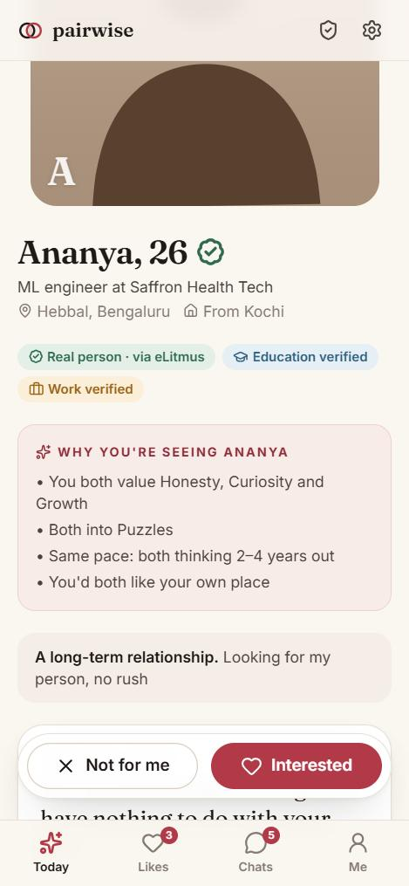
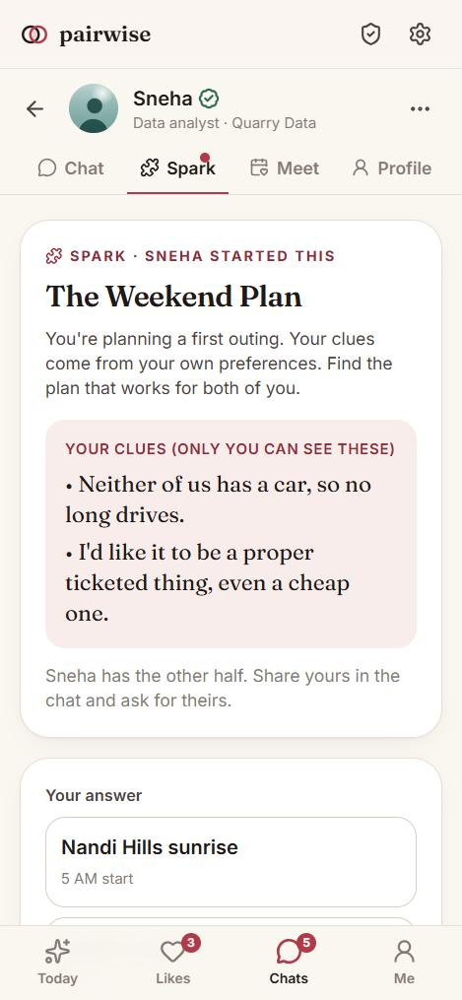
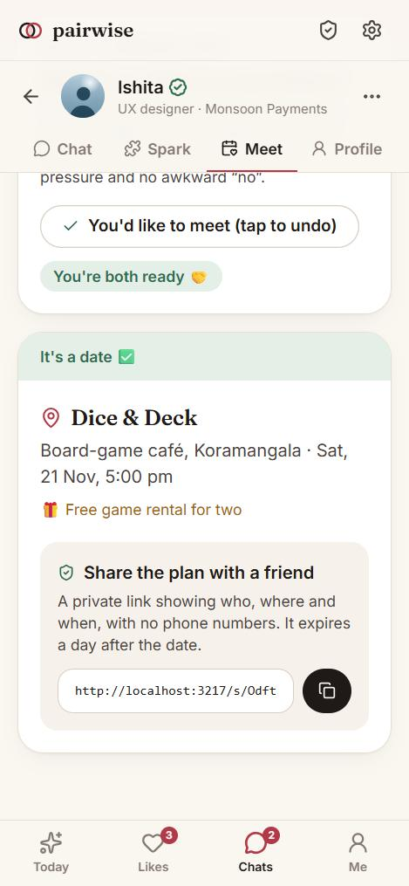
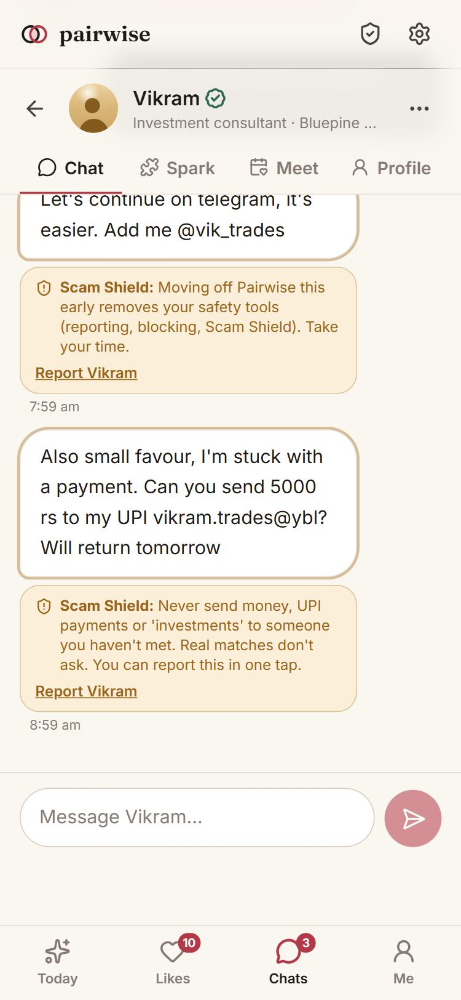

<div align="center">

# Pairwise

**Fewer matches. Real people. Conversations that start themselves.**

A verified-only, slow-dating app for India's early-career professionals,
built end to end for the eLitmus Software Developer assignment.

**[Live app](#live-demo)** · **[Founder's notes](docs/PRODUCT.md)** · **[Evaluator walkthrough](docs/DEMO.md)** · **[Submission answers](docs/SUBMISSION.md)**

</div>

<p align="center">
  
  
  
  
</p>

---

## The idea in one paragraph

eLitmus has about a million candidates from the 2020–23 batches, now 23–28,
many of whom moved cities for their first job. Each of them was
**identity-verified at a proctored test**. That's the one thing Indian dating
apps can't get, where 75% of people have run into fake profiles. Pairwise turns
that trust into a calmer, fairer, safer dating product: **verified-only**,
**five explained picks a day** ranked with **attention balancing** (so nobody
is flooded and nobody is ignored), an icebreaker called **Spark** where each
person holds half a puzzle's clues, **no-ghosting mechanics**, **privacy from
colleagues**, and a safety stack from **Scam Shield** to a **share-with-a-friend
date plan**. It makes money mostly from **businesses** (partner venues, events,
sponsored puzzles), not from users' pockets.

## Live demo

| | |
|---|---|
| **App** | _deployment URL goes here_ |
| **Password for every demo account** | `Demo@2026` |

| Account | What it shows |
|---|---|
| `aarav@pairwise.demo` | Daily Picks, a date proposal to accept, a half-solved Spark, 3 likes |
| `meera@pairwise.demo` | The inbound cap (10 likes now, 2 queued), Scam Shield catching a scam, close-kindly |
| `kabir@pairwise.demo` | Plus member: 10 picks, 5 slots, Relocation mode |
| `admin@pairwise.demo` | Founder console: north-star metric, funnel, hypotheses, moderation queue |

Or sign up fresh: verification uses a clearly labelled simulated eLitmus
consent screen (try `demo.candidate@elitmus.test`). Demo data resets nightly.
The full walkthrough is in [docs/DEMO.md](docs/DEMO.md).

## What makes it different

| Problem | Pairwise's answer |
|---|---|
| Fake profiles and romance scams | **Verified-only** (eLitmus Verify or work email) · **Scam Shield** flags money, UPI, crypto and early off-platform pressure |
| ~3:1 gender ratio, with flooded and ignored profiles | **Daily Picks** ranked by compatibility × **attention balance** · at most **10 new likes a day** per person, the rest queued |
| "hi" and ghosting | **Spark** co-op puzzles · **3 open slots** · **close kindly** in one tap · 7-day expiry |
| Colleagues seeing your profile | **Hide from my verified employer and college** · **blur until match**, enforced on the server |
| Chat that never becomes a safe date | **Date Plan**: mutual consent, public venues, share with a friend, private check-in |
| Paywalled basics | Seeing **who liked you is free**. Plus sells convenience, never safety or visibility |
| Caste-sorted matrimony | Values and life-plan matching; **no caste filters, by principle** |

Every decision, with its trade-off, is in the [founder's notes](docs/PRODUCT.md)
(also in the app at `/why`).

## Product documents

- [Product thesis](docs/PRODUCT.md): observations, hypotheses H1–H6, principles, north star
- [Go-to-market & scaling](docs/GTM.md): liquidity thresholds, women-first waves, the phases
- [Monetisation](docs/MONETIZATION.md): revenue lines and one-city unit economics
- [Legal & compliance](docs/LEGAL.md): DPDP, IT Rules, CCPA dark patterns, RBI, and how each shaped a feature
- [Architecture](docs/ARCHITECTURE.md): design decisions, data model, security, scaling path
- [Submission answers](docs/SUBMISSION.md): the three form answers

## Tech

- **Next.js 16** (App Router) + **React 19** + **TypeScript**, a mobile-first **PWA**
- **Tailwind CSS v4** with a small custom design system (Fraunces + Inter)
- **Firestore** (`asia-south1`) through a tiny `DocStore` interface; an
  **in-memory store** for tests and zero-setup local runs
- **Zod** validation, **jose** JWT sessions, **scrypt** password hashing
- **Vitest**: 100 tests over the matching engine, Scam Shield, Spark (every
  puzzle brute-forced for a unique answer) and all services
- **Vercel** (`bom1`) with a nightly cron that resets the demo scenario

```
src/
  app/            routes: marketing, auth, app (today, likes, chats, me…), admin, api/*
  components/     design-system pieces (profile view, portraits, nav…)
  lib/
    matching/     compatibility + fair ranking (pure)
    safety/       Scam Shield (pure)
    spark/        puzzles + uniqueness helpers (pure)
    services/     use cases: discovery, matches, dates, moderation, plus, account, metrics
    store/        DocStore interface · Firestore · in-memory
    seed/         50 fictional members and the demo scenario
tests/            Vitest suites
docs/             product, GTM, monetisation, legal, architecture, demo, submission
```

## Run it locally

Requires Node 20.9+.

```bash
npm install
npm run dev        # http://localhost:3000, auto-seeds the demo scenario, no setup needed
npm test           # 100 tests
npm run lint && npm run typecheck && npm run build
```

With no environment variables, the app uses an in-memory store persisted to
`.data/db.json`. Delete that file to reseed.

### Deploy (Vercel + Firestore)

1. Create a Firebase project, enable **Firestore (Native) in `asia-south1`**,
   and create a service account with the *Cloud Datastore User* role.
2. Set environment variables on Vercel (see [.env.example](.env.example)):
   `SESSION_SECRET` (a long random string), `FIREBASE_SERVICE_ACCOUNT` (JSON or
   base64), `CRON_SECRET`, `NEXT_PUBLIC_SITE_URL`.
3. `vercel deploy --prod`. Functions run in `bom1` (see `vercel.json`).
4. Seed once: log in as admin and press **Reset demo data**. The cron keeps it
   fresh nightly.

## Honest notes

- **Simulated, and clearly labelled in the UI:** eLitmus Verify (would be OAuth
  2.0 with narrow scopes), work-email delivery (the code is shown on screen),
  the Plus checkout (would be Razorpay Subscriptions), and venue partnerships.
  Everything else is real, working code.
- **Market figures** come from McAfee's *Modern Love* research (India, Feb 2026),
  Woo's 2018 survey (26% of users were women), and Info Edge's exchange filings
  on Aisle. The revenue model is illustrative, with its assumptions stated.
- **All demo members, colleges, employers and venues are fictional.** Demo
  members have generated portraits instead of real faces.

## Credits & third-party components

Scaffolded with `create-next-app`. Uses [Next.js](https://nextjs.org),
[React](https://react.dev), [Tailwind CSS](https://tailwindcss.com),
[lucide-react](https://lucide.dev) icons (ISC),
[firebase-admin](https://github.com/firebase/firebase-admin-node),
[jose](https://github.com/panva/jose), [Zod](https://zod.dev) and
[Vitest](https://vitest.dev), plus the Fraunces and Inter typefaces (SIL Open
Font License) through `next/font`. No templates or UI kits. The product design,
copy, matching logic, puzzles and visual design are original to this project.
